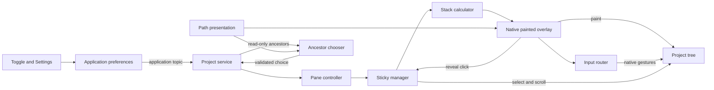

# Requirements

### Outcome and Agreed Scope
Implement the follow-up improvements selected after the completed documentation review. The user has requested implementation now; do not repeat the four completed review stages.

- Correct horizontal-scroll alignment and stale sticky rows after selection changes (`R2`, `R4`).
- Restore overlay mouse interactions (`R14`) and add full-path tooltips.
- Add an IDE-wide persistent enable/disable toggle and a configurable sticky-content height limit.
- Add a keyboard-accessible ancestor chooser, not a separately focusable overlay.
- Run the actual Starter/Driver integration tests against the configured IDEA baseline.
- Correct packaged version-specific change notes and the release workflow's changelog-update condition (`T1`, `T4`).

### Acceptance Criteria
- Native `JTree` painting, subtree handoff, selection styling, and click-to-reveal behavior remain intact. Painting aligns at nonzero horizontal scroll; navigation preserves the original horizontal position unless it must be clamped to the valid range.
- Changing selection after revealing an ancestor recalculates the sticky stack even without a viewport change.
- Decoration-only areas do not swallow tree input. Context-menu triggers on press or release, native expansion/double-click behavior, wheel scrolling, and drag gestures are handled without duplicate actions or accidental click-to-reveal during dragging.
- Sticky-row tooltips identify file-backed nodes by their full presentable path; non-file nodes use a logical ancestor chain rather than an invented filesystem path.
- Preferences apply to every open project and survive restart. Defaults are enabled and a 50% viewport-height budget; the configurable range is 10%–90%. Disabling restores the original layout and removes attachment-owned listeners; repeated toggling and pane replacement do not duplicate overlays.
- The chooser is available through Project View, Find Action, and Keymap. Arrow keys choose an ancestor, Enter reveals/selects it, and Escape cancels without selection changes. Stale choices after pane/model changes safely do nothing; no default shortcut is imposed.
- CI runs `integrationTest`, records the actual IDEA version/build, and does not accept the previous 2026.3 EAP pass as baseline evidence. Inspection queries must not repair attachment or refresh calculation.
- Packaged notes use the existing project `version` property. Release changelog PR creation depends on a defined, file-scoped change-detection output and skips unchanged content.

### Changelog and Commit Contract
- Deliver seven cohesive stages below, with exactly one dedicated bullet under the existing flat `## [Unreleased]` section and one separate commit per completed stage.
- Each commit contains only that stage's implementation, associated tests/documentation, and its changelog entry. Validate the stage before committing; record unavailable checks honestly.
- Work on the current `main` branch. Stage and commit explicit owned paths only; use path-limited commits so the already-staged `docs/PROJECT_REVIEW.md` is not accidentally included. Never use blanket staging, reset the index, amend previous commits, or rewrite history.
- Preserve the existing staged/unstaged review dossier, untracked knowledge dossier, `.agents/` files, and `.junie/` plan. Do not include them in implementation commits. Use the existing Git identity/signing configuration; report blockers rather than bypassing it.
- The implementation summary must list each commit SHA, its changelog entry, validation results, and outstanding limitations. Do not push or perform a release.

### Boundaries
Coverage reporting was not selected and remains outside scope. Do not upgrade dependencies, bump the plugin version, change licensing, add shadow/path-copy features, or undertake unrelated calculator/performance/template cleanup. Leave the two pending review documents unchanged; update `README.md` for the implemented controls and development commands.

# Technical Design

### Current Implementation
This is a single Kotlin IntelliJ plugin, version `0.0.2`. Reuse its project-scoped service, message-bus subscriptions, disposable attachment ownership, and EDT coordination rather than replacing native painting.

- `ProjectViewStickyController` owns pane attachment and layout restoration; its observation helpers currently refresh attachment.
- `StickyTreeManager` coordinates recalculation and reveal navigation. Its selection listener can clear the revealed-path exception without recalculating, and navigation helpers currently reset horizontal position.
- `StickyTreePanel` clips native tree painting and handles only primary-button navigation; its row-visibility guard also compares unscrolled X bounds to viewport width. `VisualStickyTreeItems` hardcodes a half-viewport budget with an additional row margin.
- There are no existing preference or action implementations. Follow the existing `@Service` and `messageBus.connect(disposable)` patterns; reuse the `MyBundle` wrapper for new localized strings.
- The current UI workflow launches the Robot harness but runs unit tests. Packaged notes read undeclared `pluginVersion`; the release PR guard references an absent `properties` step.

### Runtime Changes
**Scrolling and state:** Translate native painting horizontally by the negative viewport X offset and make row-visibility/skip checks viewport-relative, while retaining current vertical clipping and decoration. Capture horizontal position at the start of reveal/selection, before native handlers or `selectCB` can change it, and preserve it in manager navigation and controller row scrolling with valid-range clamping. Pointer routing must carry that original X through a completed reveal gesture. Recalculate immediately when a selection change clears a revealed path; retain the repaint-only fast path for unrelated selection changes.

**Pointer input and tooltips:** Isolate gesture routing from painting. Hit-test only visible sticky portions, preserving negative push-off offsets and parent-over-child clipping. For a sticky row, map X to `viewportX + overlayX` and Y to `rowBounds.y + overlayY - item.yLocation`; decoration input uses ordinary viewport coordinates. Capture a `TreePath` for each gesture and revalidate its current row before forwarding, rather than retaining a stale row number. Delegate native expansion/context/double-click/drag behavior and wheel scrolling to the appropriate tree/scroll-pane handlers, preserve event metadata, and prevent dispatch loops. Single-click label navigation must not also fire for an expansion, double-click, or drag gesture.

For context menus, retain the native tree's node selection/action data context but anchor the popup at the original overlay pointer position; merely forwarding offscreen row coordinates must not place the menu outside the viewport. Keep hover tooltips owned by the overlay to avoid duplicate tooltip-manager dispatch. A shared presentation helper prefers the Project View node's `VirtualFile.presentableUrl`, falls back to a clearly logical tree-path chain, and escapes any HTML-sensitive text. Register routing/tooltip resources under the existing attachment disposable and release them on detach.

**Global preferences:** Add an application-level `SerializablePersistentStateComponent` using immutable copy-on-write state stored in `sticky-project-view.xml`. Normalize height to 10%–90% on read/update; absent state uses defaults. Publish changed preference snapshots on an application message-bus topic. Each initialized project service subscribes with its own disposable and marshals preference-induced UI changes to the EDT. Controllers gate startup/pane attachment on enabled state, restore the original scroll-pane layout on disable, and guard queued work against disposal. Re-enabling reuses the existing pane attachment path without duplicate listeners.

Expose the toggle in a localized `Sticky Project View` group under `ProjectViewPopupMenu`. Add a Tools settings page using the platform UI DSL, with enabled state and a percentage spinner; Apply publishes one combined update. The calculator receives the percentage explicitly, with no dependency on the application service. Use the same value for normal recalculation and navigation previews; preserve the existing row-margin admission rule at the 50% default. The percentage budgets sticky content, excluding separator/shadow decoration.

**Keyboard navigation:** Register a dumb-aware, keymap-capable action in the same Project View group. Its platform chooser uses current ancestor snapshots and the shared path presentation, supports speed search and standard keyboard selection, then delegates directly to the manager reveal algorithm, not the blocking file-selection helper. Revalidate the active attachment and path on selection; unavailable choices return failure without navigation. Action updates use only cheap preference/attachment/count observations, with explicit update-thread declarations; resolve presentation metadata when building the chooser/tooltip, not during action update. Access Swing state only on the EDT and obtain required read access for node metadata. Keep focus in the native tree after choosing/canceling.

### Contracts
The following are the new/changed contracts; ancestor snapshots are transient UI data, not persisted state.

```kotlin
data class StickyProjectViewPreferences(
    val enabled: Boolean = true,
    val maxStickyHeightPercent: Int = 50,
)

interface StickyProjectViewSettingsListener {
    fun settingsChanged(preferences: StickyProjectViewPreferences)
}

data class StickyAncestor(
    val treePath: TreePath,
    val label: String,
    val fullPath: String,
)

// Application settings owner
fun updatePreferences(preferences: StickyProjectViewPreferences)

// Existing project service; queries never attach or recalculate
fun hasStickyAncestors(): Boolean
fun stickyAncestors(): List<StickyAncestor>
fun navigateToStickyAncestor(treePath: TreePath): Boolean

// Existing calculator; all previews use the same percentage
fun recalculate(
    visibleRect: Rectangle,
    revealedPath: TreePath? = null,
    maxStickyHeightPercent: Int = 50,
)
```

Action IDs: `StickyProjectView.Toggle`, `StickyProjectView.Configure`, and `StickyProjectView.NavigateAncestors`. Existing inspection methods retain their remote-compatible signatures but become read-only observations of the current attachment; explicit initialization/selection/navigation commands remain separate.

### Runtime Flow
Application preferences notify each project service, which controls attachment and the manager's height budget. The native-painted overlay routes pointer interaction; the chooser obtains snapshots and returns validated navigation requests through the project service.



### Build and Release
- Add one `platformVersion` Gradle property, initially `2025.3`, and use it for both compilation and the Starter `TestCase.withVersion(...)` call. Pass it explicitly to `integrationTest` and assert/log the actual baseline release/build; do not rely on Starter's default selection.
- Convert the existing UI workflow to the implemented Starter/Driver task, keeping its Linux/macOS/Windows matrix and manual trigger while adding pull-request/main-push execution. Use Java 21, the appropriate Gradle wrapper, and `xvfb-run` on Linux. Starter owns IDE launch/closure; remove obsolete Robot launch/health-check steps and its unused Gradle run configuration. Use bounded per-IDE and setup-inclusive CI timeouts, and upload JUnit reports/test reports/IDE logs on failure or success, not cached IDE distributions.
- Keep Starter's generated `/out/` and `/allure-results/` ignored through targeted `.gitignore` entries. Preserve report provenance for multiple launches instead of overwriting the only log evidence. Turn IDE-process failures into JUnit failures using the documented Starter failure-reporting seam.
- Generate packaged notes from the existing `version` provider: use matching released notes when present, otherwise Unreleased. Do not introduce a second version property or bump the version.
- In the release workflow, detect whether `CHANGELOG.md` actually changed after the existing patch/publish sequence, expose a named `changed` output, and use it instead of the undefined guard. The existing PR step must stage/commit only that file and skip empty updates. Validate the changed/unchanged branches without executing publication, uploads, pushes, or PR creation.

### File Structure
- Modify under `src/main/kotlin/info/chrzanowski/stickyprojectview/`: `ProjectViewStickyController.kt`, `StickyProjectViewService.kt`, `StickyTreeManager.kt`, `StickyTreePanel.kt`, and `VisualStickyTreeItems.kt`.
- Add beside them: `StickyTreeInputRouter.kt`, `StickyTreePathPresentation.kt`, `StickyProjectViewSettings.kt`, `ToggleStickyProjectViewAction.kt`, `StickyProjectViewConfigurable.kt`, `ConfigureStickyProjectViewAction.kt`, `StickyAncestor.kt`, and `NavigateStickyAncestorAction.kt`.
- Modify `src/main/resources/META-INF/plugin.xml` and `src/main/resources/messages/StickyProjectViewBundle.properties` for localized actions/settings registration.
- Extend `src/test/kotlin/info/chrzanowski/stickyprojectview/VisualStickyTreeItemsTest.kt`; add `StickyTreeInputRouterTest.kt`, `StickyTreePathPresentationTest.kt`, `StickyProjectViewSettingsTest.kt`, and `StickyAncestorNavigationTest.kt` in that test package. Use the existing test frameworks, with platform fixtures where services are required.
- Extend `src/integrationTest/kotlin/info/chrzanowski/stickyprojectview/StickyProjectViewUiTest.kt` for passive observations and actual pointer/action interaction.
- Modify `build.gradle.kts`, `gradle.properties`, `.github/workflows/run-ui-tests.yml`, `.github/workflows/release.yml`, `.gitignore`, `README.md`, and `CHANGELOG.md`. Leave the existing build/coverage workflow and pending review artifacts unchanged.

### Risks
Native gesture forwarding does not itself prove that context menus or drag-and-drop work on every OS; validate real interactions as well as synthetic coordinate tests and report unexercised behavior. Application-wide listeners and chooser snapshots must not outlive their project/attachment. Independent variable-height lookup, performance, and other review risks are not implicitly fixed by this work.

# Validation

### Regression and Feature Scenarios
Write focused regressions at the existing calculator/manager/panel seams before changing their behavior; reuse the EDT Swing fixtures and native-paint pixel assertions.

- **Scrolling/state:** Nonzero horizontal offsets and deep indentation align with the native tree, including rows whose unscrolled X exceeds viewport width but become visible after scrolling. Reveal and controller row navigation preserve the X from before native selection, including clamping. Selection clears a revealed path and updates items/panel height at unchanged viewport Y, without a repairing query.
- **Input/presentation:** Verify clipped-row versus decoration hit testing, captured-path revalidation, metadata-preserving press/release/double-click/drag routing, native expansion, wheel forwarding, and no duplicate reveal or dispatch loop. Check actual IDE context-menu/double-click/wheel behavior; distinguish any unexercised native OS drag transfer from tested gesture routing.
- **Tooltips:** Resolve real directory/file paths, distinguish duplicate leaf names, handle non-file nodes and missing paths, escape special characters, and show nothing on decoration-only regions. Verify tooltip resources are removed on detach.
- **Preferences/lifecycle:** Test default and serialized state, percent bounds, no-op updates, change notification, two open projects receiving the same update, repeated toggle/pane switching, original layout/listener restoration, and project disposal with queued UI work. Restart the baseline IDE using the same isolated config storage to verify persistence, preserving separate launch logs; restore test preferences afterward.
- **Height:** Check 10%, 50%, and 90%, odd/tiny/resized viewports, row-margin admission, and subtree push-off. Ensure preview/navigation and painted-stack budgets agree, with the default retaining existing behavior.
- **Chooser:** Verify ordered snapshots, duplicate-name disambiguation, disabled/empty states, keyboard choose/cancel, focus return, exact selected ancestor, and stale path/pane/model rejection. Inspection calls must not change attachment or calculation.
- **CI/release:** Assert the configured 2025.3 baseline and exact requested file/directory chain, exercise actual sticky-row interactions, and propagate IDE errors to JUnit. Validate workflow syntax/action references and changelog-changed/unchanged conditions without publishing. Inspect packaged descriptor version and both released-note/Unreleased fallback cases using isolated fixtures.

### Execution and Evidence
Run targeted tests and compilation as each stage evolves, then the full unit suite once after the final stage. Each stage includes its own validation; there is no separate testing-only delivery stage.

| Command/check | Required evidence |
|---|---|
| `./gradlew compileKotlin compileTestKotlin compileIntegrationTestKotlin` | Production and both test source sets compile without changing dependency versions |
| `./gradlew test --tests '<focused class>'` | The relevant regression/feature tests pass before that stage's commit |
| `./gradlew test` | All existing and added unit/platform tests pass together |
| `./gradlew integrationTest` | Baseline IDEA version/build, exact selection assertions, feature scenarios, JUnit XML, and IDE errors/logs |
| `./gradlew buildPlugin` and archive inspection | Correct descriptor, localized action/settings resources, and version-specific notes |
| `./gradlew verifyPlugin` | Compatibility result for configured verification targets, or a precise external blocker |
| Workflow/static fixture checks | Defined outputs, changed/unchanged release behavior, and valid runner commands without remote side effects |

The completed review recorded 8/8 unit tests and packaging success, but its 1/1 integration pass was on 2026.3 EAP and verifier completion remained blocked. Reuse those as historical evidence only; no new builds/tests have been run during this planning update. Keep realistic setup-inclusive and per-process limits, record failures versus timeouts distinctly, and report unavailable dependencies/environment requirements instead of claiming unverified compatibility.

# Delivery Steps

### ✓ Step 1: Run Starter/Driver UI tests on the configured baseline
The actual IDE scenario runs locally and in CI against IDEA 2025.3, with passive assertions and attributable failure evidence.

- Share `platformVersion` between `gradle.properties`, the Gradle platform dependency, and `StickyProjectViewUiTest` through an explicit Starter version; assert/log the launched baseline and exact requested selection.
- Make controller/service inspection methods read-only; keep explicit selection commands separate and fail on genuine missing attachment rather than silently repairing it.
- Replace the Robot launch/health-check/unit-test sequence in `run-ui-tests.yml` with `integrationTest` on its existing OS matrix, adding PR/main triggers, Linux virtual-display support, bounded timeouts, and report/log artifacts.
- Remove the now-unused Robot Gradle configuration, ignore only Starter output directories, and bridge IDE-process failures to JUnit. Update the relevant `README.md` development instructions.
- Compile both test source sets, validate the workflow, and run the baseline integration scenario when prerequisites permit; record blockers without substituting EAP evidence.
- **Changelog entry:** `Run Starter/Driver UI tests against the configured IDEA 2025.3 baseline.`
- **Separate commit:** `ci: run UI tests on the configured IDEA baseline`

### ✓ Step 2: Correct sticky scrolling and navigation state
Sticky rows align horizontally, reveal navigation preserves X, and selection changes cannot leave a stale revealed-path stack.

- Add failing geometry/state regressions to `VisualStickyTreeItemsTest.kt`, including nonzero X, visible-after-scroll rows with unscrolled indentation beyond the viewport width, and selection changes at unchanged Y.
- Fix native painting translation and viewport-relative row-visibility checks in `StickyTreePanel`, capture/preserve/clamp X before manager/controller selection operations, and force recalculation only when selection clears the revealed-path exception.
- Retain subtree handoff, native-paint clipping, and existing reveal offsets; extend the passive IDE assertions to cover the corrected behavior.
- Run the focused unit tests and compile the affected source sets before committing.
- **Changelog entry:** `Fix horizontally scrolled sticky rows and stale rows after selection changes.`
- **Separate commit:** `fix: align sticky rows and refresh navigation state`

### ✓ Step 3: Restore overlay pointer behavior and full-path hover information
The overlay preserves ordinary tree gestures and presents unambiguous path tooltips without swallowing decoration input.

- Add `StickyTreeInputRouter` and integrate it with panel/controller attachment ownership; map sticky coordinates to the current native row, preserve coherent gesture metadata, and retain pre-selection X for completed click-to-reveal gestures.
- Delegate decoration, expansion, popup-trigger, double-click, wheel, and drag behavior while keeping completed single-click label reveal and preventing duplicate actions. Keep native context-menu data bound to the tree and popup positioning bound to the actual overlay pointer.
- Add `StickyTreePathPresentation` and overlay-managed tooltips, using real file-node paths or a logical chain fallback; release routing and tooltip registrations on detach.
- Add focused router/presentation tests, update the old press-only click fixture to test the intended gesture sequence, and extend Starter/Driver checks for actual tree interaction. Update `README.md` feature descriptions.
- Run focused tests and the applicable baseline UI scenarios; distinguish tested routing from any unverified OS-native drag transfer.
- **Changelog entry:** `Restore sticky-overlay mouse interactions and show full-path tooltips.`
- **Separate commit:** `fix: restore sticky overlay interactions and path tooltips`

### ✓ Step 4: Add an IDE-wide persistent enable/disable toggle
Users can toggle sticky rows from Project View, and the preference safely updates all open projects and survives restart.

- Add `StickyProjectViewSettings` with immutable persistent preferences and an application-level change topic; establish the default 50% height field for the next stage without exposing a height control yet.
- Subscribe each project service with disposable ownership and make controllers honor enabled state during startup, pane changes, detach, and queued EDT work.
- Add/register `ToggleStickyProjectViewAction` and the localized Project View action group, using the existing bundle wrapper and explicit action update-thread declarations.
- Add settings/lifecycle tests for serialization, no-op updates, two-project propagation, repeated toggle, restored layout/listeners, and disposal. Extend the baseline IDE scenario with toggle/restart checks sharing isolated config storage, preserve separate launch logs, and restore test state afterward.
- Run focused tests and relevant compilation/UI checks; document the global scope and toggle in `README.md`.
- **Changelog entry:** `Add an IDE-wide, persistent Project View toggle for sticky rows.`
- **Separate commit:** `feat: add IDE-wide sticky view toggle`

### ✓ Step 5: Add a configurable viewport-height budget
Users can apply a 10%–90% sticky-content budget across the IDE, with the existing 50% behavior retained by default.

- Add `StickyProjectViewConfigurable` and `ConfigureStickyProjectViewAction`, register the Tools settings page and Project View entry, and localize both controls and the IDE-wide scope note.
- Pass the normalized percentage explicitly through manager recalculation and navigation previews into `VisualStickyTreeItems`; keep content budgeting distinct from separator/shadow height.
- Apply enabled/height preferences as one state update and recalculate current attachments when the limit changes, even without scrolling.
- Add percentage-bound, default-equivalence, tiny/resized viewport, push-off, and preview-consistency tests; verify Apply/Reset and live updates in the baseline IDE. Document the units and range in `README.md`.
- Run focused calculator/settings tests and compile/check the settings UI before committing.
- **Changelog entry:** `Allow configuring sticky content height between 10% and 90% of the viewport.`
- **Separate commit:** `feat: configure sticky stack height`

### ✓ Step 6: Add a keyboard-accessible sticky-ancestor chooser
A keymap-capable Project View action navigates current sticky ancestors through a native chooser without adding overlay focus handling.

- Add `StickyAncestor`, read-only service/controller snapshots, validated path navigation, and `NavigateStickyAncestorAction` using the shared presentation helper and existing reveal algorithm.
- Register/localize the action for Project View, Find Action, and Keymap; expose no conflicting default shortcut and disable it when sticky navigation is unavailable.
- Add chooser/snapshot tests for ordering, duplicate labels, empty/disabled state, cancellation, exact navigation, and stale pane/model paths; drive arrow/Enter/Escape interaction and focus return in Starter/Driver.
- Verify selected ancestors remain revealed with the configured budget and horizontal position preserved. Run focused tests, compile both test source sets, and execute the expanded baseline UI suite where supported.
- Document chooser usage and shortcut assignment in `README.md`.
- **Changelog entry:** `Add a keyboard-accessible sticky-ancestor chooser.`
- **Separate commit:** `feat: navigate sticky ancestors from the keyboard`

### ✓ Step 7: Repair packaged and release changelog handling
Plugin archives contain version-correct notes and the release workflow creates a changelog PR only for a real changelog change.

- Replace the undeclared `pluginVersion` lookup in `build.gradle.kts` with the existing `version` provider and retain released-note/Unreleased fallback behavior.
- Add explicit `CHANGELOG.md` change detection in `release.yml`; use its defined output to guard the PR step and restrict release staging/committing to that file.
- Validate workflow syntax and changed/unchanged branches in isolated fixtures without running publishing, release uploads, pushes, or PR creation. Build and inspect the plugin archive, including action/settings resources and change notes.
- Run the complete unit suite and final packaging/compatibility checks as validation of the completed implementation; record verifier/network/UI limitations and confirm only stage-owned changes are committed. Do not bump the project version.
- **Changelog entry:** `Use the actual plugin version for packaged notes and detect release changelog changes before creating a pull request.`
- **Separate commit:** `fix: correct packaged and release changelog handling`