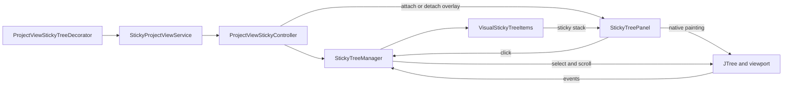

# Sticky Project View: project knowledge

## Scope and evidence

This dossier describes the current checkout, not a comparison with a commit. It covers product intent, repository organization, runtime implementation, platform foundations, development and release operations. Findings, validation outcomes and prioritized recommendations live in [PROJECT_REVIEW.md](PROJECT_REVIEW.md). Configuration and source inspection are not proof of successful execution or compatibility.

Paths below are relative to the repository root. Production filenames in the inventory are relative to `src/main/kotlin/info/chrzanowski/stickyprojectview/`. The review excludes caches, untracked IDE-local state, binary contents, and generated output; tracked project metadata is included. Their presence does not establish source behavior. Existing local files were preserved.

## Product purpose and promised behavior

Sticky Project View is a Kotlin IntelliJ Platform plugin that keeps the directory context visible while navigating deep Project View trees. It augments the existing tree rather than introducing another project browser.

The following are **documented promises**, shared by [`README.md`](../README.md) (lines 3–9) and [`plugin.xml`](../src/main/resources/META-INF/plugin.xml) (lines 6–14):

| Promise | Supporting implementation evidence, not full behavioral verification |
| --- | --- |
| Expanded parent directories remain pinned at the top while scrolling. | `VisualStickyTreeItems.recalculate` computes sticky paths from the visible tree; `ProjectViewStickyController` overlays a panel at the viewport top. |
| Rows preserve native arrows, icons, colors, and selection. | `StickyTreePanel.paintComponent` clips/translates graphics and calls the original `tree.paint`, rather than assembling replacement renderers. Appearance across all themes and scroll positions has not been verified here. |
| Clicking a sticky row reveals/selects it while retaining parents above it. | The panel's left-button handler delegates to `StickyTreeManager.navigateTo`; navigation uses a revealed-path state and preview calculations. This is implemented intent, not a claim of correctness for all geometries. |

README also states that unit, rendering, and UI integration tests exist. Both source sets exist; eight unit/rendering tests passed during this review. After an initial timeout, the cached IDE scenario passed on 2026.3 EAP, not the 2025.3 baseline (see the review's validation ledger).

The README's Features section spans lines 11–16, with its test-existence claim on line 16; these statements are documentation, not additional verification.

### Documented evolution

[`CHANGELOG.md`](../CHANGELOG.md) has an empty `Unreleased` section and two releases:

- **0.0.1 — 2025-12-02:** initial implementation, expanded parent directories pinned while scrolling.
- **0.0.2 — 2026-04-13:** click-to-reveal navigation and Starter/Driver UI tests; native rendering and a separator/shadow; documented fixes for nested handoff, click positioning, and dark-theme edge handling.

These are historical changelog statements, not independently reproduced fixes. The declared current project version is `0.0.2` in `gradle.properties`.

### Terminology

- **Project View / pane:** IntelliJ's existing project browser and its currently selected `AbstractProjectViewPane`.
- **Tree / row / path:** the pane's Swing `JTree`, its current displayed row index, and a `TreePath` identifying a model node. Rows are not stable node identifiers.
- **Viewport:** the visible portion of the tree inside its `JScrollPane`.
- **Sticky item / stack:** a calculated path/row/y-position record and the ordered collection painted above the scrolled content.
- **Handoff:** a sticky row moving out as its subtree boundary approaches the stack; the stored y-position can be negative.
- **Revealed path:** the navigation target excluded from the sticky stack so it can appear in the real tree beneath its parents.
- **Attachment:** the controller-owned association of a tree, scroll pane, overlay, calculator, manager, disposable, and original layout.

## Runtime implementation and contracts

The following trace is **source-confirmed implementation**, not observed IDE behavior or a claim that every edge case works. Source links refer to the current checkout; line ranges identify the relevant methods. The runtime has no backend or persistent settings layer.

### Startup, attachment and lifetime

- [`plugin.xml`](../src/main/resources/META-INF/plugin.xml), lines 19–23, registers the resource bundle and `postStartupActivity`. [`ProjectViewStickyTreeDecorator.execute`](../src/main/kotlin/info/chrzanowski/stickyprojectview/ProjectViewStickyTreeDecorator.kt), lines 15–20, queues initialization on Swing's EDT with `invokeLater`, checks `project.isDisposed` inside that callback, then obtains the project service.
- [`StickyProjectViewService`](../src/main/kotlin/info/chrzanowski/stickyprojectview/StickyProjectViewService.kt), lines 9–32, constructs one controller and registers it as a disposable child. Its own `dispose` is empty: child disposal supplies cleanup. Its remaining methods delegate to the controller, including the inspection/selection interface used by integration tests.
- [`ProjectViewStickyController`](../src/main/kotlin/info/chrzanowski/stickyprojectview/ProjectViewStickyController.kt), lines 26–42 and 113–119, connects to the project message bus with itself as disposable owner and handles `ProjectViewListener.paneShown`. Initialization looks up the current view ID and pane through a cast to `ProjectViewImpl`; a failed cast or absent current pane means there is nothing to initialize. This is coupling to the platform implementation, not merely the `ProjectView` interface.
- `attachToPane` (controller lines 81–111) requires a pane tree and an ancestor `JScrollPane`; either missing prerequisite detaches the old attachment. The same tree identity reuses its attachment and forces an update (it does not check scroll-pane identity). A different tree first detaches, then creates a calculator, click-callback panel, manager and attachment-specific disposable. The manager is registered under that disposable. There is no timer/retry loop for a tree unavailable at initialization; subsequent pane events or inspection calls are other attachment opportunities.
- Installation (controller lines 134–144, 192–206) saves the current layout, adds the panel directly to the scroll pane, sets its component z-order to zero, and replaces the layout with a `ScrollPaneLayout` subclass. After normal scroll-pane layout, the overlay gets the viewport's x/y/width and the panel's preferred height. It covers the viewport rather than reserving tree space; its height includes decoration.
- Detach/disposal (controller lines 77–79, 121–129, 172–190) disposes the attachment's listener owner, removes the panel if it is still a child of that scroll pane, unconditionally reinstates the saved layout, then revalidates/repaints. Controller detach clears its attachment reference. Thus original-layout restoration is explicit; it does not merge intervening layout changes or restore an earlier component z-order snapshot. Controller-owned message-bus subscriptions follow controller disposal.

### Events, caching and thread expectations

[`StickyTreeManager`](../src/main/kotlin/info/chrzanowski/stickyprojectview/StickyTreeManager.kt), lines 36–122 and 138–169, coordinates the mutable calculator and panel:

| Event/entry point | Actual action |
| --- | --- |
| Viewport change | Recalculate only when the complete `viewport.viewRect` differs from the cached rectangle; always refresh/repaint the panel. Width, height and horizontal position participate in equality. |
| Tree expansion/collapse; model node/structure events | Force recalculation and repaint. |
| `model` property replacement | Remove the listener from the old model, observe the new model and force recalculation; the null-model branch clears items and repaints. |
| `rowHeight` property | Force recalculation. |
| `cellRenderer` / `font` properties | Repaint/remeasure panel, without explicitly recalculating items. |
| Selection change | Clear the revealed-item marker if the selected path differs; repaint only. |
| Focus gain/loss | Repaint only, allowing native focus/selection appearance to be repainted. |
| `forceUpdate` | Reset the cached rectangle and explicitly force recalculation. |

Manager disposal removes the viewport, expansion, selection, focus, property and observed-model listeners (lines 204–211). These listener registrations have explicit disposable ownership, rather than relying on garbage collection alone.

Swing component access, mutation and painting rely on EDT usage. Startup dispatches to the EDT, and controller `withAttachment`/selection operations use `onEdt`, which runs directly on the EDT or uses synchronous `invokeAndWait`, propagating exceptions (controller lines 131–132, 160–170). In contrast, `initialize`, the pane callback, `dispose`/detach and manager methods do not independently marshal or assert EDT execution. Their callers/event sources must supply the appropriate thread; this inspection did not verify all platform callback/disposal threading.

### Calculator: eligibility, geometry and stack budget

[`StickyTreeItem`](../src/main/kotlin/info/chrzanowski/stickyprojectview/StickyTreeItem.kt), lines 6–10, contains `treePath`, current `row`, and panel-relative `yLocation`; it stores neither renderer nor bounds nor clipped height. [`VisualStickyTreeItems`](../src/main/kotlin/info/chrzanowski/stickyprojectview/VisualStickyTreeItems.kt) owns a mutable list and integer content height. `items()` exposes that list as `List`, not a copied snapshot; `clear()` resets both (lines 117–124).

`recalculate` (lines 19–111), bounded by `tree.rowCount`, clears previous results, then returns empty for an empty rectangle, zero rows, negative viewport y, or y=0 with no revealed path. Its loop builds the stack as follows:

1. Start with depth `d=0`, content height `P=0`, and lookup position `L=visibleRect.y + P`. Find a row at that position, form its root-to-row path chain, and retain paths with `getRowForPath >= 0`. A hidden root is therefore filtered out. Take chain entry `d`; the chain is recomputed at each depth, not captured once for the entire stack.
2. Stop if the chain has no entry at that depth, the candidate equals the revealed path, or the candidate is not expanded/non-leaf. Eligibility tests model nodes, not filesystem directory types. Require a current row and bounds; candidate height is `h=max(bounds.height,1)`.
3. Normally the candidate's real row top must be strictly above `L`. Equality is allowed only when a revealed path exists beneath that candidate (prefix comparison) and the candidate is not itself the revealed path. Stop also if `P + 2*h > visibleRect.height / 2` (integer division).
4. Scan following displayed rows until the path ceases to have the candidate as a prefix. The last such row's bottom defines subtree boundary `B` (lines 132–168). This uses expanded/displayed descendants, not the entire model's descendants.
5. Compute `overlap=max(L+h-B,0)` and `visibleHeight=h-overlap`. Stop if this height is nonpositive. Otherwise append `(path,row,yLocation=P-overlap)`, increase `P` by `visibleHeight`, and increment depth. Stop immediately after a positive overlap, or if the same budget predicate with the just-used `h` and updated `P` is true; otherwise repeat.

**Geometry consequences, inferred from these formulas:** the new row's unclipped bottom `yLocation+h` equals the updated content height. Handoff shifts the last row upward as the subtree bottom approaches; `yLocation` can be negative for a first row or can overlap earlier rows at deeper levels. Do not assume disjoint row rectangles or nonnegative offsets. Only positive-height entries are appended, and only the final appended entry can have positive handoff overlap because that terminates the loop. The calculator's budget concerns content, not separator/shadow height; it is not simply “fill half the viewport.” The post-add test uses the same row height, not the next candidate's height.

Row lookup (lines 170–193) uses `max(tree.rowHeight,1)` to estimate `topY / rowHeight`, clamps that index, backs up one row, and scans **forward only** using actual row bounds. Rows whose bottom is at or before `topY`, or which have null bounds, are skipped; if the scan reaches the end it returns its fallback or the last row. This is the actual lookup strategy, not a demonstrated arbitrary-variable-height guarantee. Subtree scanning is repeated per candidate; no performance measurements were made here.

### Native painting, coordinates and clicks

[`StickyTreePanel`](../src/main/kotlin/info/chrzanowski/stickyprojectview/StickyTreePanel.kt), lines 33–139, is nonopaque, uses no child layout, and tracks viewport width, calculator content height and decorated panel height. Empty items make it invisible with height zero. Otherwise preferred height is content plus a one-pixel separator and computed shadow. Size changes cause revalidation; every refresh repaints.

For painting, the panel traverses items in **reverse order**, so earlier ancestors paint last over overlapping later entries. It reads current row bounds using the stored row index. Painting/hit-testing use `max(bounds.height, max(tree.rowHeight,1))`, unlike the calculator's `max(bounds.height,1)`. For each row at panel offset `s`, visible interval is `[max(s,0), min(s+h,contentHeight))`; missing bounds, empty intervals and certain width checks skip painting. A graphics child starts at `(0,visibleTop)` with full panel width and that interval's height. After filling tree background, translation is `(0, s-visibleTop-rowBounds.y)` before `tree.paint`. Thus a tree y-coordinate `t` appears at panel y=`t+s-rowBounds.y`; native row top lands at `s`, clipped to the content interval. There is **no horizontal translation** by viewport x: tree x-coordinates are reused directly. While painting and hit-testing share the same clipped vertical intervals, painting skips items when `rowBounds` are null or `x >= width`, whereas hit-testing does not apply these skips and uses default row height if bounds are missing. Native painting retains the existing tree's renderer/UI state instead of synthesizing replacement labels; this alone does not verify every theme or horizontal-scroll appearance.

The separator is painted at content height and a black-to-transparent gradient below it. Shadow strength grows with the final item's clipped-away fraction; height is derived from its row height with a minimum of five pixels, and alpha differs for bright/dark themes (panel lines 142–219).

Left `mousePressed` events only are handled. Hit-testing first rejects coordinates outside panel bounds, then checks items in **forward order** against the same clipped vertical intervals. Any x within panel width qualifies; it is not restricted to the node text or native expand arrow. This makes overlap hits favor the ancestor painted last. Decoration below content has no matching item. A hit consumes the event and calls the manager; clicks are not forwarded to native arrow expansion or other tree mouse handlers (panel lines 37–47, 120–135).

### Click navigation and revealed-path state

[`StickyTreeManager.navigateTo`](../src/main/kotlin/info/chrzanowski/stickyprojectview/StickyTreeManager.kt), lines 124–136 and 171–202, resolves the clicked path's **current** row and bounds, returning if absent. It computes `maxY=max(max(tree.height, tree.preferredSize.height)-viewportHeight,0)` and starts target y at the row top clamped to `[0,maxY]`. Up to **four iterations** create a fresh calculator, preview the current viewport rectangle with y replaced by the target and the clicked path marked revealed, then set the next target to `clamp(rowTop-previewContentHeight,0,maxY)`. An unchanged target returns early; otherwise the fourth result is returned without an additional convergence requirement. This is a bounded adjustment algorithm, not proof of convergence for every tree.

Navigation then performs one additional height preview for logging, stores `(clickedPath,targetY)` as revealed state, selects the path, requests focus, sets viewport position to **`Point(0,targetY)`**, and forces an update. Horizontal scrolling is therefore reset. The reveal preview excludes the clicked path and stops deeper stacking, while the equality exception described above permits ancestor rows at the lookup top. The intended outcome is the real clicked row beneath remaining pinned parents; runtime success for all geometries has not been verified.

On recalculation the marker is passed to the calculator only while the actual viewport y equals the stored target; otherwise it is cleared. A selection change to another path also clears it. Width/height/x changes alone do not invalidate it if y stays equal. Selection-triggered clearing repaints but does not itself force a geometry recalculation (manager lines 39–45, 88–100).

### Inspection/selection interface and diagnostic support

Controller inspection methods (`isAttached`, sticky labels, panel height, visible-row labels, selected-path labels; lines 44–57, 126–132) are **not passive snapshots**: each runs on the EDT through `currentAttachment`, which invokes `attachToPane(currentPane())`. `currentPane()` is null when the `ProjectViewImpl` cast fails, the current view ID is null, or no pane exists for that ID; in that case these methods **detach** the existing overlay. With a non-null pane, a missing tree or missing ancestor `JScrollPane` are separate detach paths inside `attachToPane` and affect `initialize()` identically; if the tree has changed, the overlay is **replaced**. The only asymmetry with `initialize()` is the null-pane case: inspection detaches, `initialize()` does nothing. When attached, they attempt to refresh stale state before reporting it. “Visible row labels” enumerates all displayed/expanded tree rows, not only rows intersecting the viewport; selected labels omit the first/root path component. Defaults are false, zero or empty lists when no attachment exists. Panel height includes decoration, unlike calculator content height.

`selectPath` (controller lines 59–75, 146–158) resolves joined segments under `project.basePath` through local VFS refresh/find, invokes `ProjectViewImpl.selectCB(null,file,false)` on the EDT, then waits up to **30 seconds** for the callback to be *processed* (meaning completed or rejected) outside that EDT helper. There is no prohibition on an EDT caller, so the helper does not guarantee a background wait. It returns false early if `resolveFile` fails (no base path or file not found). When `waitFor` returns true (callback processed before the timeout, including rejection), it refreshes attachment and checks only that *some* current selection has a displayed row; this return value does not distinguish a successful selection from a rejected one. It then scrolls that row toward the viewport top within the maximum y, resets x to zero and forces an update. It does not compare final labels to requested segments and does not use sticky-click navigation/revealed state. Service-driven selection and real overlay clicks are distinct operations.

[`StickyTreeDebugLogger`](../src/main/kotlin/info/chrzanowski/stickyprojectview/StickyTreeDebugLogger.kt), lines 14–99 and 101–153, emits `[SPV]` attachment, manager, calculation, painting and navigation snapshots only when its IntelliJ logger has debug enabled. Snapshots include tree identity, geometry, stack paths and up to eight rows around the visible start (not necessarily eight actually intersecting rows). Paths/labels use node `toString`, so debug output can contain project names. Logger-side message construction is gated, but calculator `steps` and panel `placements` strings are built by callers before that gate (calculator lines 21–111; panel lines 84–113).

[`StickyProjectViewBundle.kt`](../src/main/kotlin/info/chrzanowski/stickyprojectview/StickyProjectViewBundle.kt), lines 7–19, defines `MyBundle`, a `DynamicBundle` wrapper providing immediate and lazy messages. A source search for `MyBundle` found only its declaration; none of the traced runtime modules uses it. The registered properties file contains sample `projectService`, `randomLabel` and `shuffle` messages, not sticky-row UI text. These are inventory facts, not a proposal to remove them.

### Validation boundary for this runtime trace

Step 2 used targeted numbered IDE file reads of all nine production modules, the descriptor, localization properties and existing dossier, plus a source search for `MyBundle`. No terminal commands, builds, tests, IDE launches or publication operations were run; there are no execution outcomes to report. This documentation-only change leaves source and tests unchanged. Geometry, startup timing, disposal threading and navigation observations above are derived from code; exercised behavior and review findings belong to the subsequent runtime/coverage and tooling audit steps.

## Repository map

This is a single Gradle project (`rootProject.name = "sticky-project-view"`), not a multi-module application. The Gradle group is `com.github.hsz.stickyprojectview`; the actual Kotlin package is `info.chrzanowski.stickyprojectview`. Neither is the plugin ID, which is `sticky-project-view`.

### Production Kotlin inventory

| File | Source-confirmed responsibility |
| --- | --- |
| [`ProjectViewStickyTreeDecorator.kt`](../src/main/kotlin/info/chrzanowski/stickyprojectview/ProjectViewStickyTreeDecorator.kt) | Descriptor-registered `ProjectActivity`; schedules initialization with `SwingUtilities.invokeLater` and checks project disposal. |
| [`StickyProjectViewService.kt`](../src/main/kotlin/info/chrzanowski/stickyprojectview/StickyProjectViewService.kt) | `@Service(Service.Level.PROJECT)`, owns a disposable controller; exposes initialization, attachment/label/height inspection, and path selection. |
| [`ProjectViewStickyController.kt`](../src/main/kotlin/info/chrzanowski/stickyprojectview/ProjectViewStickyController.kt) | Subscribes to project pane changes; finds the tree/scroll pane, creates and removes attachments, installs an overlay layout, and restores the original layout. Uses `ProjectViewImpl` and provides EDT-coordinated inspection/selection helpers. |
| [`StickyTreeManager.kt`](../src/main/kotlin/info/chrzanowski/stickyprojectview/StickyTreeManager.kt) | Coordinates viewport, expansion, selection, focus, model, and property events with recalculation/repainting; handles click navigation and removes listeners on disposal. |
| [`VisualStickyTreeItems.kt`](../src/main/kotlin/info/chrzanowski/stickyprojectview/VisualStickyTreeItems.kt) | Calculates the sticky stack from visible expanded non-leaf paths, subtree bounds, and a viewport-height budget; accepts a revealed path. |
| [`StickyTreeItem.kt`](../src/main/kotlin/info/chrzanowski/stickyprojectview/StickyTreeItem.kt) | Data record containing `treePath`, `row`, and `yLocation`. |
| [`StickyTreePanel.kt`](../src/main/kotlin/info/chrzanowski/stickyprojectview/StickyTreePanel.kt) | Native clipped tree painting, separator/shadow geometry, sizing, and left-click hit testing. |
| [`StickyTreeDebugLogger.kt`](../src/main/kotlin/info/chrzanowski/stickyprojectview/StickyTreeDebugLogger.kt) | IntelliJ logger with `[SPV]` attachment, manager, calculation, navigation, and paint diagnostics; output is guarded by debug logging. Snapshots can include node/path labels. |
| [`StickyProjectViewBundle.kt`](../src/main/kotlin/info/chrzanowski/stickyprojectview/StickyProjectViewBundle.kt) | Defines the object **`MyBundle`**, a `DynamicBundle` wrapper with message and lazy-message helpers. |

The implementation is in-process IntelliJ/Swing UI coordination. There is no application backend, external service client, or persistent settings implementation in the inspected production sources. The descriptor declares no user settings page, toggle action, or separate tool window. Those absences describe the current source, not a requirement to add such features.

### Resources and metadata

| Path | Role / observed contents |
| --- | --- |
| [`src/main/resources/META-INF/plugin.xml`](../src/main/resources/META-INF/plugin.xml) | Plugin ID `sticky-project-view`, name `Sticky Project View`, vendor `hsz`, product description, platform/lang module dependencies, resource bundle, and post-startup extension. No literal version or IDE build range is written in this source descriptor; generated values are documented under platform foundations below. |
| [`pluginIcon.svg`](../src/main/resources/META-INF/pluginIcon.svg), [`pluginIcon_dark.svg`](../src/main/resources/META-INF/pluginIcon_dark.svg) | 40×40 vector plugin icons with light/dark palette variants; not tree-row renderers. |
| [`src/main/resources/messages/StickyProjectViewBundle.properties`](../src/main/resources/messages/StickyProjectViewBundle.properties) | Keys `projectService`, `randomLabel`, and `shuffle`, with project-service/random-number/shuffle text. These do not describe the sticky UI. A Kotlin reference search found only the `MyBundle` definition, not callers. |
| [`src/test/testData/rename/foo.xml`](../src/test/testData/rename/foo.xml), [`foo_after.xml`](../src/test/testData/rename/foo_after.xml) | Sample XML rename pair (`a1` with a caret marker → `a2`). No `testData` reference was found in the Kotlin sources; the existing sticky tests construct trees in code. |
| [`LICENSE`](../LICENSE) | MIT License, copyright 2025–2026 Jakub Chrzanowski. Eight of nine production Kotlin files carry JetBrains 2000–2025 Apache 2.0 headers; `StickyProjectViewBundle.kt` and both test source files do not. This records differing provenance notices, not a legal determination; see review T8. |

### Tests

| Source | Structure and exercised intent (not execution results) |
| --- | --- |
| [`src/test/kotlin/info/chrzanowski/stickyprojectview/VisualStickyTreeItemsTest.kt`](../src/test/kotlin/info/chrzanowski/stickyprojectview/VisualStickyTreeItemsTest.kt) | Eight JUnit 4 Swing tests: full sticky height, subtree slide-out, collapse updates without scrolling, parent/child paint overlap, tree chrome outside the renderer, separator/shadow painting, click-to-reveal positioning, and navigation target offset. Runs test bodies on the EDT; fixture uses hidden root, fixed `rowHeight = 20`, synthetic tree nodes, and image painting. |
| [`src/integrationTest/kotlin/info/chrzanowski/stickyprojectview/StickyProjectViewUiTest.kt`](../src/integrationTest/kotlin/info/chrzanowski/stickyprojectview/StickyProjectViewUiTest.kt) | One JUnit Jupiter Starter/Driver test, `stickyItemsFollowExpandedProjectViewPath`. Creates a local project with six nested directories, 160 deep files and 80 root files; installs the built plugin into an IU IDE, opens Project View, and remotely calls the project service to select `DeepFile120.txt` and assert sticky labels/positive panel height. This is service-driven selection, not an IDE sticky-row mouse click. |

The integration test maps a `@Remote` interface to the production service by plugin ID. Its inspection methods are not passive probes: controller `withAttachment` calls `currentAttachment`, which refreshes attachment and forces an update for an already attached tree. See review R12/R13 for startup/update and selection coverage limitations.

### Build and automation files

| Path | Role |
| --- | --- |
| [`settings.gradle.kts`](../settings.gradle.kts) | Project name, plugin versions, Foojay toolchain resolver, Maven Central and IntelliJ default repositories. |
| [`build.gradle.kts`](../build.gradle.kts) | Kotlin/Platform/Changelog plugins, IDEA dependency, tests and custom integration source set/task, change-note generation, publication dependency, and robot-enabled IDE launch. |
| [`gradle.properties`](../gradle.properties) | Group/version; disables default Kotlin stdlib dependency; enables configuration cache and build cache. |
| [`gradle/wrapper/gradle-wrapper.properties`](../gradle/wrapper/gradle-wrapper.properties), `gradle-wrapper.jar`, `gradlew`, `gradlew.bat` | Gradle wrapper metadata, bootstrap binary, and Unix/Windows launchers. Binary contents were not reviewed. No version-catalog file was found under `gradle/`; dependencies are declared directly despite the build comment mentioning a catalog. |
| [`.gitignore`](../.gitignore) | Ignores `.DS_Store`, `.gradle`, `.idea`, `.intellijPlatform`, `.kotlin`, `.qodana`, and `build`; tracked IDE metadata is still included in this inventory. |
| [`.idea/gradle.xml`](../.idea/gradle.xml) | Tracked IDE Gradle project metadata; explicitly sets `gradleJvm` to `21`. This is a source-controlled IDE assumption even though `.idea` is otherwise ignored. |
| [`.run/Run Plugin.run.xml`](../.run/Run%20Plugin.run.xml), [`.run/Run Tests.run.xml`](../.run/Run%20Tests.run.xml), [`.run/Run Verifications.run.xml`](../.run/Run%20Verifications.run.xml) | Tracked shared IDE run configurations for Gradle tasks `runIde`, `check`, and `verifyPlugin`, respectively. |
| [`.github/workflows/build.yml`](../.github/workflows/build.yml) | Pushes to `main` and pull requests: packages with `buildPlugin`; dependent jobs run `check`, Qodana, and `verifyPlugin`; uploads artifacts/reports and requests a Kover XML upload. A non-PR release-draft job depends on all four jobs, deletes old drafts, and creates a new draft from project version and unreleased notes. These are configured actions, not verified successful gates. |
| [`.github/workflows/run-ui-tests.yml`](../.github/workflows/run-ui-tests.yml) | Manual Linux/Windows/macOS matrix; launches `runIdeForUiTests`, polls robot server port 8082, then invokes **`test`**, not `integrationTest`. |
| [`.github/workflows/release.yml`](../.github/workflows/release.yml) | On released/prereleased GitHub releases, checks out the tag, optionally patches notes, invokes `publishPlugin`, uploads distributions, and contains a conditional changelog PR step. Publication was not invoked or validated. |
| [`.github/dependabot.yml`](../.github/dependabot.yml) | Daily updates for Gradle and GitHub Actions at the repository root. |
| [`qodana.yml`](../qodana.yml) | Community JVM linter `2024.3`, JDK 21, `qodana.recommended`, excludes `.qodana`; build workflow uses Qodana action `v2025.1.1`. |
| [`codecov.yml`](../codecov.yml) | Project and patch coverage statuses are informational; project threshold is 0%, base `auto`. This does not establish that a coverage report is generated. |
| [`README.md`](../README.md), [`CHANGELOG.md`](../CHANGELOG.md), [`LICENSE`](../LICENSE) | Product claims, documented evolution, and root licensing metadata. |

## Platform and dependency foundations

| Component | Declared value / source |
| --- | --- |
| Project version | `0.0.2` — `gradle.properties:2`. |
| Kotlin JVM plugin | `2.1.20` — `settings.gradle.kts:7`. |
| IntelliJ Platform Gradle settings/plugin infrastructure | `2.14.0` — `settings.gradle.kts:14`; build applies `org.jetbrains.intellij.platform`. |
| Gradle | Wrapper `9.4.1` — wrapper properties. |
| Compile/development platform | `intellijIdea("2025.3")` — `build.gradle.kts:38`. |
| Java | Workflows select Zulu **21**, Qodana declares JDK **21**, and tracked `.idea/gradle.xml` sets IDE `gradleJvm` to **21**. The build does not explicitly set a Java/Kotlin toolchain or JVM target. Foojay resolver plugin `1.0.0` is registered in settings; this alone is not an explicit toolchain selection. |
| Changelog plugin | `2.5.0` — settings. |
| Unit testing | JUnit **4.13.2**, IntelliJ `TestFrameworkType.Platform`. |
| Integration testing | JUnit BOM **5.10.3**, Jupiter, platform launcher, coroutines-core-jvm **1.10.1**, Kotlin reflect/stdlib at runtime, IntelliJ `TestFrameworkType.Starter`. Integration configurations extend unit-test configurations and include main output. |
| Runtime plugin requirements | `com.intellij.modules.platform` and `com.intellij.modules.lang` — descriptor. |
| Robot launch support | `robotServerPlugin()` for the named `runIdeForUiTests` configuration. |

The production imports rely on IntelliJ Platform APIs and Java Swing/AWT, including the concrete `ProjectViewImpl`. No separate third-party production library is explicitly declared beyond the platform/Kotlin build setup. `kotlin.stdlib.default.dependency = false` is configuration, not evidence that every Kotlin runtime compatibility condition is satisfied.

IDEA 2025.3 is the declared build platform, not a verified support matrix for other IDE products/builds. Likewise, the manual three-OS workflow expresses test intent, not evidence that those operating systems pass. The packaging check produced `build/distributions/sticky-project-view-0.0.2.zip`; its nested plugin JAR descriptor has version `0.0.2`, `since-build="253"`, no `until-build` and no change-notes element. A sampled `StickyTreeItem.class` has class-file major version 65 (Java 21). This incremental build ran under host Temurin 25.0.3, not CI's Java 21; it does not establish clean-build portability.

No explicit `pluginVerification.ides` list is configured. Nevertheless, `verifyPlugin` attempted to resolve `idea:idea:2025.3.6.1`; absence of a handwritten list is **not** absence of effective default targets in Platform Gradle Plugin 2.14.0. Neither bounded verification attempt reached a compatibility verdict. Starter's `TestCase(IdeProductProvider.IU, ...)` also has no pinned IDE build; the integration attempt chose IU `263.6800.24` (2026.3 EAP), distinct from the compile platform.

## Development entry points

Run commands from the repository root with the checked-in wrapper (`gradlew.bat` on Windows). JDK 21 matches CI; first runs can require network access for Gradle, platform and test dependencies. UI checks require a graphical environment or appropriate display setup. Execution results and bounds are in the review; the table describes task intent, not universal success.

| Command | Purpose and source |
| --- | --- |
| `./gradlew runIde` | Standard IntelliJ Platform plugin development launch; not separately customized in this build. |
| `./gradlew test` | Existing JUnit 4 unit/rendering tests. |
| `./gradlew check` | Lifecycle check invoked by build CI; do not assume it runs the separately registered `integrationTest` task. |
| `./gradlew buildPlugin` | Compile/package plugin; CI consumes archives under `build/distributions`. Passed incrementally in about 24 seconds here. Inspect the nested JAR's `META-INF/plugin.xml`, not just source metadata. |
| `./gradlew verifyPlugin` | Verification command invoked by CI; allow target/verifier downloads. Here the online attempt timed out at 120 seconds; offline failed on an uncached IDEA target, not a plugin incompatibility. Reports normally go to `build/reports/pluginVerifier`. |
| `./gradlew integrationTest` | Custom Starter/Driver IDE test. Depends on `prepareSandbox`, uses JUnit Platform, passes the sandbox plugin directory as `path.to.build.plugin`, and logs passed/skipped/failed events plus standard streams (`build.gradle.kts:75–90`). |
| `./gradlew runIdeForUiTests` | Separate robot-server launch on port 8082 with privacy/consent/dialog JVM flags (`build.gradle.kts:92–110`); distinct from the Starter/Driver test above. |
| Shared IDE configurations | `.run/Run Plugin.run.xml` runs `runIde`; `.run/Run Tests.run.xml` runs `check` (not directly `test`); `.run/Run Verifications.run.xml` runs `verifyPlugin`. |

### Release process as configured

The build workflow prepares a GitHub release draft only on non-PR runs after packaging, checks, inspection, and verification jobs. It reads `version` via Gradle properties and obtains unreleased notes with `getChangelog`. Publishing that draft (or a prerelease) triggers the release workflow, which checks out the tag and runs publication.

The release job supplies environment variables named `PUBLISH_TOKEN`, `CERTIFICATE_CHAIN`, `PRIVATE_KEY`, and `PRIVATE_KEY_PASSWORD`; no secret values were accessed. Platform Gradle Plugin **2.14.0 already binds these names by convention**: `Publishing.register` binds the token and `Signing.register` binds chain/key/password in the [versioned upstream extension source](https://github.com/JetBrains/intellij-platform-gradle-plugin/blob/2.14.0/src/main/kotlin/org/jetbrains/intellij/platform/gradle/extensions/IntelliJPlatformExtension.kt#L657-L665) (signing at lines 772–782). Missing explicit DSL assignments here are not a credential-binding defect. Default publishing channel is `default`, with `hidden=false`; the workflow does not separately route prereleases. Secret presence, certificate validity, Marketplace authorization and successful signing remain untested.

`build.gradle.kts:69–73` makes `publishPlugin` depend on `patchChangelog`. Release notes can first be passed to that patch task via a temporary file (`release.yml:47–57`); publishing then builds/uploads and GitHub receives distributions as assets. The change-notes provider reads **`pluginVersion`**, whereas `gradle.properties` declares **`version`**: the produced descriptor has no notes even though 0.0.2 has changelog entries. The release PR condition references `steps.properties.outputs.changelog` without a corresponding step ID, so it cannot observe a real changelog output. Draft generation reads the empty current Unreleased section, not the existing 0.0.2 section. These discrepancies and follow-ups are in the review. No signing, publication, changelog patching, draft deletion/creation or release-changing command was run.

Before an authorized release, validate version/tag/changelog consistency, inspect the packaged descriptor, complete tests and verifier checks, confirm the intended prerelease channel, and verify secrets through the authorized release system without exposing their contents. The current workflows are a description of automation, not a declaration of release readiness.

### Automation gates and report locations

- Build CI packages first; independent `test`, `inspectCode` and `verify` jobs depend on packaging, and the non-PR release draft depends on all four. The jobs check out source independently rather than testing a downloaded packaging artifact.
- `check --dry-run --offline` shows the unit-test task but no `integrationTest` or coverage task. There is no Kover plugin in the applied build plugins, despite Codecov expecting `build/reports/kover/report.xml`. Codecov statuses are informational, not coverage gates.
- Manual UI CI starts a robot-server IDE, polls port 8082, then runs `test`; it does not execute the Starter/Driver scenario. Linux uses system `gradle` for launch rather than the wrapper used elsewhere.
- Qodana uses community JVM 2024.3, JDK 21, `qodana.recommended`, and excludes only `.qodana`; its action is v2025.1.1. This is separate from Platform Plugin verification and no Qodana execution was performed locally.
- Dependabot checks root Gradle and GitHub Actions dependencies daily; Qodana's image tag in YAML is not a configured Docker update ecosystem.
- Unit results: `build/test-results/test/` and `build/reports/tests/test/`. Integration uses `build/test-results/integrationTest/` plus Starter's `out/ide-tests/` and Allure output. `out/` and `allure-results/` are not covered by the current `.gitignore`; generated UI artifacts are not source or deliverables. The session-created `out/` (7.1 GB) and `allure-results/` (964 KB) trees were removed after capturing run evidence, but future UI runs can recreate these unignored paths.

## Checks performed and remaining uncertainty

- Read README, descriptor, changelog, root license, build/settings/properties/wrapper metadata, all three workflows, Dependabot, Qodana and Codecov configuration; inventoried both test sets and all nine production Kotlin files plus resources and XML fixtures.
- Used scoped directory/path tools and focused source reads. A Kotlin text search for test names, `MyBundle`, `testData`, and persistent-state annotations/interfaces found eight named unit tests, only the bundle definition, and no fixture or persistence references.
- The structure-extraction tool could not parse the Kotlin files; direct numbered IDE file reads provided evidence instead. IDE reads require an explicit project path in this environment.
- The earlier capture/trace stages were source-only; subsequent stages ran `test` (8/8 passed), `buildPlugin` (passed), bounded `verifyPlugin` (timeout, then offline dependency failure), and `integrationTest --offline` (initial 120-second setup-inclusive timeout; cached rerun passed 1/1 in about 53 seconds with a 600-second cap on IU 263.6800.24). Exact commands, warnings, session-created artifact sizes and completed cleanup are recorded in the review.
- No production source, tests, assets or configuration were changed. No performance measurement, manual IDE interaction, Qodana run, signing or publication was performed. Licensing provenance and broad compatibility remain unresolved; absent coverage is not a reproduced defect.